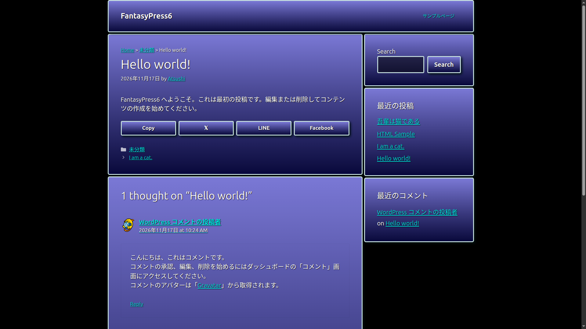

# FantasyPress6

A retro RPG-inspired child theme for the WordPress theme **GeneratePress**.
Designed for gamers, streamers, VTubers, and geeks who love the nostalgic charm of **classic 8-bit and 16-bit RPG menu screens**.

## Features
* **Classic Retro RPG Aesthetic**: Minimalist color palette and clean CSS styling that faithfully recreate the warm nostalgia of classic 8-bit/16-bit RPG interfaces.
* **Fully Compatible with RPGPress2**: Shares the exact same functionality and structure as **FantasyPress7** (a richer, "HD Remaster" style), allowing you to easily switch themes whenever you want a makeover.
* **Built-in Breadcrumbs**: Easy navigation for your visitors without needing extra plugins.
* **Custom Share Buttons**: Styled social share buttons ready to use out of the box.
* **Lightweight & Fast**: Inherits the speed and stability of GeneratePress.

## Requirements
* WordPress 6.0 or higher
* **GeneratePress** (Parent theme must be installed)
* PHP 8.0 or higher

## Installation

1. Go to the **[Releases]** section on the right side of this page and download the latest `FantasyPress6.zip` file. *(Note: Do not use "Download ZIP" from the green Code button, as it may cause folder structure issues.)*
2. Log in to your WordPress dashboard and go to **Appearance > Themes > Add New**.
3. Click **Upload Theme** at the top, select the `FantasyPress6.zip` file, and click **Install Now**.
4. Once installed, click **Activate**. *(Make sure GeneratePress is already installed.)*

## Disclaimer
* This child theme requires the **GeneratePress** parent theme to function.
* The author is not responsible for any issues or data loss caused by using this theme. Please back up your site before installation.

## License
This theme is licensed under the [GNU General Public License v2 or later](https://gnu.org).

